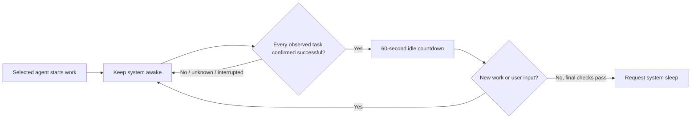

<p align="center">
  
</p>

<h1 align="center">SleepDock</h1>

<p align="center">
  <strong>Stay awake for your agents. Sleep after confirmed completion.</strong><br>
  A frosted desktop widget for sleep schedules, lid behavior, and local AI agent protection.
</p>

<p align="center">
  
  
  
  
  <a href="LICENSE"></a>
</p>

<p align="center">
  <a href="README.md">简体中文</a> · English ·
  <a href="https://github.com/k1ubbh0ppers/SleepDock/releases/tag/v1.1.1">Download</a> ·
  <a href="docs/AGENTS.md">Agent integration</a> ·
  <a href="CHANGELOG.md">Changelog</a> ·
  <a href="docs/BUILD.md">Build guide</a>
</p>

SleepDock is a local desktop sleep-control widget. Choose when your computer sleeps, keep it awake for selected agents, configure lid behavior, and optionally sleep after a whole batch of tasks has explicitly completed. The frosted window has a fixed width and a manually adjustable height. Hide, disable, or quit directly from the widget.

It is built for people who leave long-running agent tasks on a laptop, and for everyday sleep timers, AC-only protection, and independent display controls.

> **Release status:** macOS has a native Swift app; Windows and Linux have Electron packages. Windows/Linux packages are cross-built and code-checked, but have not been validated on physical target systems. The six default agents have different detection capabilities. Automatic sleep after completion requires reliable completion events.

## What it does

| Goal | SleepDock behavior |
| --- | --- |
| Sleep after a period without input | Idle sleep, configurable from 1–1440 minutes |
| Sleep a fixed time from now | Countdown timer with a cancellation window |
| Keep long tasks running | Never-sleep mode or selected-agent protection |
| Sleep after successful agent work | Confirm every task in the batch, then wait 60 seconds without input |
| Choose what closing the lid does | System default, sleep, or keep running, subject to platform capabilities |
| Protect only selected tools | Six defaults, saved selections, and custom apps |
| Fit a small desktop area | Fixed 390 width, bottom resize handle, separate compact/expanded heights |
| Stop the widget | `×` quits and releases protection; `−` hides to menu bar or tray |

## Actual interface

<p align="center">
  
</p>

This interface image comes from the running macOS app. The interior remains frosted; pixels outside the rounded corners are transparent. Version 1.1.1 removes the outer white stroke and native window shadow. Windows 11 uses acrylic where supported; Linux blur depends on the desktop compositor. **The current app interface is in Simplified Chinese.**

The header image is a generated illustration of the product scenario, not a feature screenshot or hardware-test result.

## Download and run

Open [v1.1.1 Releases](https://github.com/k1ubbh0ppers/SleepDock/releases/tag/v1.1.1) and choose your platform.

| System | Asset | Launch |
| --- | --- | --- |
| macOS 14+ · Apple Silicon | `SleepDock-macOS-arm64.zip` | Extract and open `SleepDock.app`; moving it to Applications is recommended |
| Windows · x64 | `SleepDock-Windows-x64.zip` | **Extract the complete folder**, then open `SleepDock.exe` |
| Linux · glibc x64 graphical desktop | `SleepDock-Linux-x64.tar.gz` | Extract and run `./启动SleepDock.sh` |
| Complete project source | GitHub Source code archive | Includes both implementations, documentation, and homepage media |

Windows/Linux packages include Electron; Node.js is not required to run them. Keep all files in the extracted package. The optional generic command wrapper requires Python 3.

The master switch and “sleep after agents complete” are off on first launch. Inspect detection status before enabling them. Packages do not have commercial release signing: the macOS app is ad-hoc signed and not Developer ID notarized. If platform security blocks a package, building from source is an alternative; disabling system security is not required.

## Agent protection and completion

DeepSeek Harness, Codex, WorkBuddy, Muse, Claude Code, and Cindy are selected by default. Selection enables monitoring; it does not imply precise completion integration for every tool.

| Agent / adapter | macOS | Windows / Linux | Confirmed completion for automatic sleep |
| --- | --- | --- | --- |
| Codex | Local lifecycle events | Local lifecycle events | Yes, with a compatible lifecycle log |
| DeepSeek Harness | App-running protection | Process-running protection | No by default; a runnable CLI can use the wrapper |
| WorkBuddy | App-running protection | Process-running protection | No by default; a runnable CLI can use the wrapper |
| Muse | App-running protection | Process-running protection | No by default; a runnable CLI can use the wrapper |
| Claude Code | App / CLI-running protection | Process-running protection | No by default; the wrapper is recommended |
| Cindy | Local running-task metadata | Process-running protection | No reliable distinction between success and interruption |
| Generic `sleepdock-run` command | Heartbeat and process exit state | Heartbeat and process exit state | Yes, exit code 0 without interruption |
| Custom selected app | App-running protection | Process-running protection | No by default |

Process-based protection is conservative: an open app keeps protection active; app exit is not treated as successful task completion. Automatic sleep may therefore keep waiting. Deselect tools that do not need protection, or wrap supported command-line tools.



SleepDock rechecks task and power state before requesting sleep. Historical completions, lost heartbeats, app exit, archived sessions, and log timeouts are not proof of success. See [Agent integration](docs/AGENTS.md) for exact behavior and wrapper examples.

## Lid behavior and platform differences

Ordinary idle-sleep protection cannot guarantee prevention of hardware lid sleep, low-battery shutdown, forced system sleep, or manual sleep.

| Platform | Keep running | Sleep on lid close | Disable / quit cleanup |
| --- | --- | --- | --- |
| macOS | Requires AC and separate authorization; uses the private `disablesleep` setting and affects system-wide sleep | Detects lid close and requests sleep; the system may act first | Watchdog restores the saved `SleepDisabled` value |
| Windows | Temporarily sets the current power plan's AC/DC lid actions to do nothing | Temporarily sets lid actions to sleep | Watchdog restores the saved AC/DC values |
| Linux | Uses a temporary logind lid inhibitor | Requires an ACPI/UPower lid sensor; desktop policy may act first | Releases the inhibitor |

Keep-running mode requires external power and adequate ventilation. Do not put a running, closed laptop in a bag. Force-killing the privileged macOS watchdog may require recovery on the next authorized activation or manual recovery from its saved record. A force-killed Windows watchdog is recovered on the next launch. See the [English guide](docs/USER_GUIDE.en.md) and platform guides for details.

## Everyday controls

- Low-battery protection, with a default threshold of 20%.
- AC-only protection that releases when external power is absent.
- Separate keep-display-awake, display-off, lock, and system-sleep actions.
- Always-on-top switch, compact mode, and frosted-depth control.
- Saved heights for compact and expanded layouts.
- Native macOS launch-at-login support; no built-in Windows/Linux startup switch yet.
- Menu-bar/tray access and complete quit from the widget.

## Local data and privacy

SleepDock does not require an account or configure a cloud task service. Detection runs locally using installed-app information, processes, and necessary lifecycle metadata. Current adapters do not display or separately store conversation bodies.

Codex session files can contain conversation text; the parser extracts only lifecycle fields. The generic wrapper stores task IDs, names, PIDs, timestamps, agent IDs, and states. It does not save the wrapped command text or output. Avoid placing sensitive information in custom task names. See [Agent integration](docs/AGENTS.md) for storage locations.

## Build from source

### Native macOS app

Requires macOS, Xcode Command Line Tools, a Swift compiler, and Python 3. The current distributed target is Apple Silicon with a macOS 14 deployment target.

```sh
cd macos
bash scripts/check.sh
bash scripts/build-app.sh
open build/SleepDock.app
```

The build produces an ad-hoc signed app. Building does not enable power rules.

### Windows / Linux implementation

Use a Node.js version supported by the dependencies. Development and packaging currently use Node 24 and Electron 45.0.0.

```sh
cd cross-platform
npm ci
npm test
npm start
```

```sh
npm run package
```

The packaging script builds Windows x64 and Linux x64 directories, under `cross-platform/dist/` by default. Runtime downloads require a network connection. Cross-building does not verify target-system power behavior.

## Validation status

| Scope | Verified | Still required |
| --- | --- | --- |
| Native macOS | Build and ad-hoc signature verification; 85 policy, parsing, completion, and window checks; 8 isolated watchdog simulations; actual UI, saved resize/selection state, assertion creation/release, and transparent-pixel checks | Actual lid close, requested sleep, lock, administrator authorization, login startup, and older supported macOS versions |
| Cross-platform implementation | 82 Node checks; wrapper success/interruption checks; Electron UI smoke test on macOS; PE/ELF, packaged resources, and archive consistency | Actual Windows/Linux startup, permissions, system-library compatibility, and power behavior |

These are functional check counts, not energy-saving percentages or task-success benchmarks. Development did not put the working computer to sleep. The [macOS validation record](macos/验证记录.md) and [cross-platform validation record](cross-platform/验证记录.md) describe the 2026-10-22 baseline.

## FAQ

**Why does protection remain after my agent appears idle?**

Some adapters can only observe whether an app or process is running. They keep protecting while it remains open and do not invent a successful terminal state. Deselect that tool or use the command wrapper where available.

**Does never-sleep mode permanently change power settings?**

Ordinary protection is temporary and released on quit. Lid keep-running is a separate feature with platform-specific changes and recovery behavior, described above.

**Can I turn off the screen while tasks continue?**

Display and system sleep controls are separate. Availability depends on the OS; display-off is disabled on Wayland when no supported interface exists.

**Why is there no blur or tray on my Linux desktop?**

Those features depend on the compositor, desktop environment, and tray extensions. Relaunching the same app can restore a hidden window.

**Are Intel Mac, Windows ARM, or Linux ARM packages available?**

Current distribution targets are macOS arm64, Windows x64, and Linux x64. Other architectures have no published package or validation claim.

## Repository layout

```text
macos/             Native Swift / SwiftUI app, checks, and lid watchdog
cross-platform/    Electron app, platform power helpers, and Node checks
assets/            Project illustration and actual interface image
docs/              Agent integration, English guide, and delivery notes
CHANGELOG.md       Release history
README.md          Chinese homepage
```

## Documentation and contributing

- [Build guide](docs/BUILD.md): toolchains, packaging, offline runtimes, and CI.
- [Agent integration](docs/AGENTS.md): adapter precision and generic command examples.
- [English user guide](docs/USER_GUIDE.en.md), [macOS Chinese guide](macos/使用说明.md), and [Windows/Linux Chinese guide](cross-platform/使用说明.md).
- [Contributing](CONTRIBUTING.md): issue reports, changes, and validation expectations.
- [Security](SECURITY.md): reporting permission, power recovery, and task-state vulnerabilities.
- [Media sources and prompt](docs/MEDIA.md): generated project art versus actual app captures.

When reporting issues, include OS version, SleepDock version, detection mode, and reproduction steps. Remove task content, personal paths, and credentials before sharing logs. Platform adapters and test contributions are welcome; distinguish code checks, simulations, and actual hardware results.

Homepage organization is inspired by [Ponytail](https://github.com/DietrichGebert/ponytail). SleepDock provides its own code, wording, and media, and does not reuse Ponytail's results or feature claims.

## License

SleepDock is released under the [MIT License](LICENSE). Copyright © 2026 SleepDock contributors. Third-party dependencies retain their own licenses. The software is provided “as is” under that license; release-signing and hardware-validation limits are described above.
