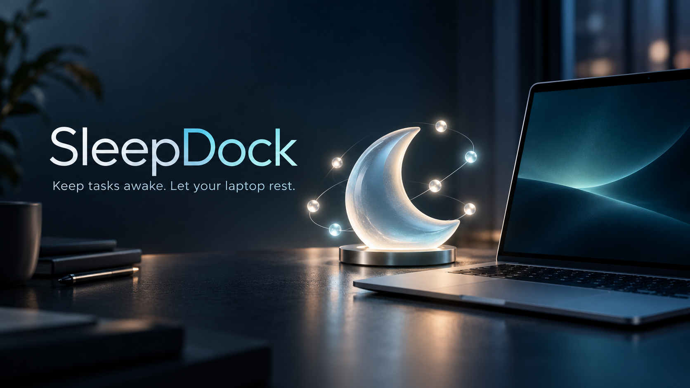
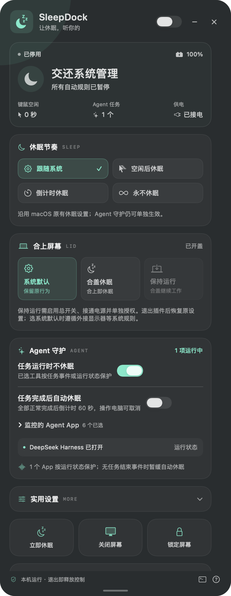
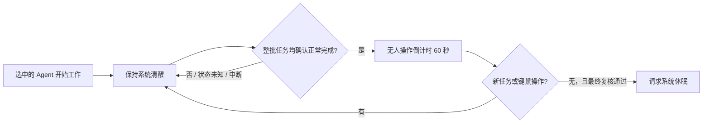

<p align="center">
  
</p>

<h1 align="center">SleepDock</h1>

<p align="center">
  <strong>Agent 工作时保持清醒，确认完成后安心休眠。</strong><br>
  A frosted desktop widget for sleep schedules, lid behavior, and local AI agent protection.
</p>

<p align="center">
  
  
  
  
  <a href="LICENSE"></a>
</p>

<p align="center">
  简体中文 · <a href="README.en.md">English</a> ·
  <a href="https://github.com/k1ubbh0ppers/SleepDock/releases/tag/v1.1.1">下载</a> ·
  <a href="docs/AGENTS.md">Agent 接入</a> ·
  <a href="CHANGELOG.md">更新记录</a> ·
  <a href="docs/BUILD.md">构建说明</a>
</p>

SleepDock 是一个本地运行的桌面休眠控制插件。你可以选择多久后休眠、持续保持清醒、合盖后的行为，以及哪些 Agent App 工作时需要保护。界面采用透明磨砂风格，宽度固定，高度可手动调整；直接在插件上即可隐藏、停用或完全退出。

它适合把长任务交给 Agent 后离开电脑的人，也适合需要定时休眠、接电保活、屏幕独立熄灭的小型桌面工作流。

> **当前发布状态**：macOS 提供原生 Swift App，Windows/Linux 提供 Electron 运行包。Windows/Linux 已完成交叉打包与代码检查，尚未真机验收。六款默认 Agent 的检测精度不同；只有可靠的正常完成事件能够触发“任务完成后自动休眠”。详见下方能力表。

## 一眼看懂

| 需要做的事 | SleepDock 的方式 |
| --- | --- |
| 连续不用电脑一段时间后休眠 | 空闲后休眠，支持 1–1440 分钟 |
| 从现在开始计时，到点休眠 | 倒计时休眠，到期保留取消窗口 |
| 长任务期间别自动睡着 | 永不休眠，或启用 Agent 任务保护 |
| 任务正常完成后自动休眠 | 整批任务逐项确认完成，再倒计时 60 秒 |
| 选择合盖后的行为 | 系统默认、合盖休眠、保持运行，受平台能力与权限约束 |
| 只保护指定 Agent | 六款默认全选，可取消、保存并添加其他程序 |
| 桌面空间有限 | 固定 390 宽，底部拖柄调高，紧凑与展开各自记忆 |
| 不想继续运行插件 | `×` 完全退出并释放保护；`−` 隐藏到菜单栏或托盘 |

## 真实界面

<p align="center">
  
</p>

界面图来自 macOS 实际运行。窗口内部保留磨砂，四个圆角外透明；1.1.1 移除了外圈白色描边与窗口阴影。Windows 11 在系统支持时使用 acrylic，Linux 模糊效果取决于桌面合成器。当前界面语言为简体中文。

顶部主视觉为生成插画，用于表达产品场景；它不是功能截图或硬件测试证据。

## 下载与启动

前往 [v1.1.1 Releases](https://github.com/k1ubbh0ppers/SleepDock/releases/tag/v1.1.1)，下载与你的系统匹配的文件。

| 系统 | 下载文件 | 启动方式 |
| --- | --- | --- |
| macOS 14+ · Apple Silicon | `SleepDock-macOS-arm64.zip` | 解压，打开 `SleepDock.app`；建议放入“应用程序” |
| Windows · x64 | `SleepDock-Windows-x64.zip` | **完整解压**，打开 `SleepDock.exe` |
| Linux · glibc x64 图形桌面 | `SleepDock-Linux-x64.tar.gz` | 解压，运行 `./启动SleepDock.sh` |
| 完整项目源码 | GitHub 的 Source code 归档 | 包含 macOS 与跨平台源码、文档及主页素材 |

Windows/Linux 运行包已包含 Electron，不必另装 Node.js。请保留运行包内完整目录。通用命令接入另需 Python 3。

首次启动总开关默认关闭，“任务完成后自动休眠”也默认关闭。先查看检测状态，再按需启用。运行包尚未进行商业代码签名；macOS 使用本地临时签名，未做 Developer ID 公证。遇到系统拦截时可先从源码构建，不需要关闭系统安全保护。

## Agent 工作时保护，完成后再休眠

默认勾选 DeepSeek Harness、Codex、WorkBuddy、Muse、Claude Code、Cindy。勾选代表“纳入监控”，不代表六款都已接入精确任务结束事件。

| Agent / 接入方式 | macOS | Windows / Linux | 可确认正常完成并自动休眠 |
| --- | --- | --- | --- |
| Codex | 本地任务生命周期事件 | 本地任务生命周期事件 | 可以，需兼容的生命周期日志 |
| DeepSeek Harness | App 运行状态保护 | 进程运行状态保护 | 默认不能；可包装可运行的 CLI |
| WorkBuddy | App 运行状态保护 | 进程运行状态保护 | 默认不能；可包装可运行的 CLI |
| Muse | App 运行状态保护 | 进程运行状态保护 | 默认不能；可包装可运行的 CLI |
| Claude Code | App / CLI 运行状态保护 | 进程运行状态保护 | 默认不能；推荐通用命令接入 |
| Cindy | 本地运行元数据 | 进程运行状态保护 | 默认不能可靠区分正常完成与中断 |
| `sleepdock-run` 通用命令 | 心跳与命令退出状态 | 心跳与命令退出状态 | 可以，退出码 0 且未中断 |
| 用户添加的其他程序 | App 运行状态保护 | 进程运行状态保护 | 默认不能 |

运行状态保护采用保守方式：程序开着就保持保护，退出不冒充“任务成功”。这可能使完成后自动休眠持续等待。你可以取消不需要监控的程序，或给支持命令行运行的工具使用通用包装器。



休眠前会再次读取任务与电源状态。历史完成记录、任务失联、App 退出、会话归档、日志超时均不作为正常完成依据。完整规则和接入示例见 [Agent 接入文档](docs/AGENTS.md)。

## 合盖控制与平台差异

普通“防空闲休眠”不能保证覆盖硬件合盖、低电量、系统强制或用户主动休眠。

| 平台 | 保持运行 | 合盖休眠 | 退出或停用时 |
| --- | --- | --- | --- |
| macOS | 需接电、单独授权；使用未公开 `disablesleep` 设置，影响系统整体休眠 | 检测合盖后请求休眠，系统可能先执行原策略 | 守护恢复此前保存的 `SleepDisabled` 原值 |
| Windows | 临时将当前电源方案的 AC/DC 合盖动作设为不操作 | 临时将合盖动作设为睡眠 | 守护恢复保存的 AC/DC 原值 |
| Linux | 使用 logind 临时合盖抑制器 | 需 ACPI/UPower 合盖传感器，桌面策略可能先执行 | 释放临时抑制器 |

保持运行需要维持接电与散热。请勿把合盖运行的笔记本放入包中。macOS 合盖守护若被管理员强制杀死，可能需要下次授权恢复或依记录人工恢复；Windows 守护被强杀也需下次启动恢复。详见 [macOS 使用说明](macos/使用说明.md) 和 [Windows/Linux 使用说明](cross-platform/使用说明.md)。

## 顺手的小功能

- 低电量保护，默认阈值 20%，避免保活耗尽电池。
- 仅接电保护，拔电后释放保护。
- 屏幕常亮独立开关；熄屏、锁屏与系统休眠分别操作。
- 置顶开关、紧凑模式、磨砂深度调节。
- 紧凑与展开模式分别保存窗口高度。
- macOS 登录时启动；Windows/Linux 当前未提供内置开机启动开关。
- 菜单栏或托盘重新显示窗口，插件内直接完全退出。

## 本地数据与隐私

SleepDock 不需要账号，不设置云端任务服务。任务检测在本机完成：读取进程、安装状态及必要的生命周期元数据；当前适配器不展示或另存聊天正文。

Codex 日志文件本身可能包含聊天内容，解析器只提取任务生命周期字段。通用包装器保存任务 ID、名称、PID、时间、来源和状态，不保存被包装命令文本或其输出。请不要把敏感内容写入自定义任务名称。详细路径见 [Agent 接入文档](docs/AGENTS.md)。

## 源码构建

### macOS 原生 App

需要 macOS、Xcode Command Line Tools、Swift 编译器和 Python 3。当前运行包面向 Apple Silicon，部署目标 macOS 14。

```sh
cd macos
bash scripts/check.sh
bash scripts/build-app.sh
open build/SleepDock.app
```

构建脚本生成本地临时签名 App。构建不自动启用电源规则。

### Windows / Linux 版

使用符合依赖要求的 Node.js；当前开发与打包使用 Node 24、Electron 45.0.0。

```sh
cd cross-platform
npm ci
npm test
npm start
```

```sh
npm run package
```

打包脚本生成 Windows x64 和 Linux x64 目录，默认输出到 `cross-platform/dist/`。运行时下载需要网络。跨系统打包成功不等于目标硬件电源行为已通过验收。

## 已验证什么

| 范围 | 已完成的验证 | 尚未完成 |
| --- | --- | --- |
| macOS 原生 | 构建与临时签名校验；85 项策略、解析、完成判断和窗口检查；8 项隔离守护模拟；真实界面、调高保存、勾选保存、断言创建释放及透明像素检查 | 真实合盖、主动休眠、锁屏、管理员授权、登录启动与旧版系统真机验收 |
| 跨平台代码 | 82 项 Node 检查；通用包装器成功/中断检查；macOS 上 Electron 界面冒烟；PE/ELF、包资源和归档一致性检查 | Windows/Linux 真机启动、权限、系统库与电源行为验收 |

这些是功能检查数量，不是节电率或任务成功率基准。开发中未让正在工作的电脑实际休眠。原始验证范围见 [macOS 验证记录](macos/验证记录.md) 与 [跨平台验证记录](cross-platform/验证记录.md)，记录基准日期为 2026-10-22。

## 常见问题

**为什么 Agent 已经不工作了，电脑仍保持清醒？**

部分工具目前只能判断 App 或进程是否运行。程序仍开着就继续保护；没有可靠正常终态时，不自动推断任务成功。可取消该工具的勾选，或使用通用命令接入。

**“永不休眠”会永久修改系统设置吗？**

普通模式使用运行期间的临时保护，退出后释放。合盖“保持运行”是独立功能，使用平台专用接口与恢复机制，具体影响见上文。

**能只关屏、不让任务停止吗？**

可以分别控制屏幕与系统睡眠；具体熄屏按钮取决于系统能力。Wayland 缺少统一接口时会禁用该按钮。

**为什么 Linux 没有磨砂或托盘？**

背景模糊与托盘显示依赖桌面环境及扩展。某些桌面隐藏后可再次启动同一程序找回窗口。

**支持 Intel Mac、Windows ARM 或 Linux ARM 吗？**

当前分发目标只有 macOS arm64、Windows x64、Linux x64，其他架构未提供发布包与验收。

## 项目结构

```text
macos/             Swift / SwiftUI 原生 App、检查与合盖守护
cross-platform/    Electron App、平台电源 helper 与 Node 检查
assets/            项目主视觉与真实界面图
docs/              Agent 接入、英文指南与交付说明
CHANGELOG.md       版本记录
README.en.md       完整英文主页
```

## 文档与贡献

- [完整构建说明](docs/BUILD.md)：工具链、平台打包、离线运行时与 CI。
- [Agent 接入](docs/AGENTS.md)：六款工具的检测精度与通用命令示例。
- [英文使用指南](docs/USER_GUIDE.en.md)、[macOS 中文说明](macos/使用说明.md)、[Windows/Linux 中文说明](cross-platform/使用说明.md)。
- [参与贡献](CONTRIBUTING.md)：问题报告、修改与验证约定。
- [安全反馈](SECURITY.md)：权限、电源恢复与任务状态漏洞的报告方式。
- [介绍图片来源与提示词](docs/MEDIA.md)：生成主视觉和真实界面的区别。

反馈问题请附系统版本、SleepDock 版本、检测方式及复现步骤。分享日志前移除任务内容、个人路径与凭据。欢迎改进平台适配和验证；请清楚区分代码检查、模拟与真机结果。

项目介绍结构参考 [Ponytail](https://github.com/DietrichGebert/ponytail)，SleepDock 的代码、文案与素材独立提供；未使用其项目成绩或功能声明。

## 许可证

SleepDock 采用 [MIT 许可证](LICENSE)。Copyright © 2026 SleepDock contributors。第三方依赖保留各自许可证。软件按许可证中的“按原样”条款提供；发布包的签名与硬件验证范围见上文。
